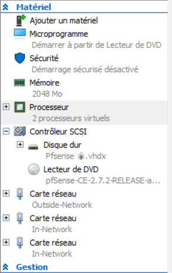

# 🛡️ pfSense : routeur et pare-feu pas à pas (Hyper-V)

> Installez **pfSense**, le pare-feu/routeur open source plébiscité par les entreprises de toutes tailles : léger, complet et simple d'utilisation quand il est bien configuré. Ce guide couvre l'installation, la configuration en console et l'assistant web.

## 📑 Sommaire

1. [Présentation](#-présentation)
2. [Prérequis et architecture](#-prérequis-et-architecture)
3. [Étape 1 : Installer pfSense](#étape-1--installer-pfsense)
4. [Étape 2 : Configuration en console](#étape-2--configuration-en-console)
5. [Étape 3 : Assistant web](#étape-3--assistant-de-configuration-web)
6. [Étape 4 : Tableau de bord et règles](#étape-4--tableau-de-bord-et-règles-de-pare-feu)
7. [Dépannage](#-dépannage)

## 🎯 Présentation

**pfSense** est un pare-feu open source qui fait aussi office de **routeur**. Il appartient à Netgate (Rubicon Communications) et repose sur **FreeBSD** (de la famille Unix, mais ce n'est **pas** Linux).

- Un **routeur** fait communiquer plusieurs réseaux entre eux, par exemple votre réseau local avec Internet.
- Un **pare-feu** (*firewall*) contrôle les flux autorisés à entrer et sortir : il n'accepte que ce qui est **explicitement autorisé** par ses règles et rejette le reste.

Quelques exemples de règles :

- autoriser le web sécurisé (HTTPS) mais bloquer le HTTP non chiffré ;
- autoriser les connexions **SSH** entrantes vers une machine, mais pas **Telnet**, non sécurisé.

pfSense s'administre via une **interface web** : il faut donc un poste client avec un navigateur, dans le même réseau local.

## ✅ Prérequis et architecture

Version utilisée : **pfSense CE 2.7.2 (amd64)**. Récupérez l'ISO sur le [site officiel](https://www.pfsense.org/download/).

Les besoins sont très légers (voir les [exigences officielles](https://docs.netgate.com/pfsense/en/latest/hardware/minimum-requirements.html)) :

pfSense agit comme un routeur : il lui faut **au moins 2 cartes réseau**, sur 2 réseaux différents.

| Interface | Rôle | Configuration dans ce guide |
|---|---|---|
| **WAN** | Côté Internet | Carte en **NAT** |
| **LAN** | Réseau local | Carte sur un réseau **privé** |

Voici l'infrastructure réalisée :

## Étape 1 : Installer pfSense

Insérez l'ISO dans la VM dédiée et démarrez-la. L'installation se fait **au clavier**.

**1.** Appuyez sur **Entrée** pour accepter la licence.

**2.** Vérifiez que **Install** est sélectionné (utilisez les flèches), puis **Entrée**.

**3.** Partitionnement : choisissez **Auto (UFS)**.

**4.** Confirmez l'utilisation du disque entier : **Entire Disk**.

**5.** Gardez le schéma **GPT (GUID Partition Table)**.

**6.** L'installeur propose un découpage sur le disque `da0`. Rien à modifier : placez-vous sur **Finish**.

**7.** Dernier avertissement avant l'effacement du disque : sélectionnez **Commit**.

**8.** L'installation démarre (quelques secondes seulement).

**9.** Quand on vous propose d'ouvrir un shell, choisissez directement **Reboot**.

> 💡 N'oubliez pas de **retirer l'ISO** de la VM pour ne pas relancer l'installateur.

Au démarrage, pfSense détecte et configure ses interfaces et services, comme le montre cette capture (WAN, LAN, DNS Resolver…) :

## Étape 2 : Configuration en console

Une fois le démarrage terminé, la console affiche le menu principal :

On y voit les deux interfaces : le **WAN** a obtenu une IP en **DHCP**, et le **LAN** porte l'adresse par défaut `192.168.1.1`, que nous allons changer. Les **16 menus** s'utilisent en tapant leur numéro puis **Entrée**.

### 2.1 Tester la connexion Internet (menu 7)

Tapez `7` pour lancer un **ping**.

Pingez `google.com` pour valider l'accès Internet et la résolution DNS.

> ⌨️ **Attention** : le clavier est en **QWERTY** par défaut. Pour taper le point (`.`), appuyez sur la touche `/`.

Le ping passe : l'interface WAN est fonctionnelle ✅

### 2.2 Configurer l'adresse IP du LAN (menu 2)

Il faut donner au LAN l'adresse de **votre** réseau local, qui sera la passerelle du réseau. Dans ce guide : `192.168.3.1/24`.

**1.** Tapez `2` (*Set interface(s) IP address*).

**2.** Choisissez l'interface à modifier : le **LAN** est ici le numéro `2`.

**3.** *Configurer l'IPv4 via DHCP ?* Répondez **`n`** (adresse manuelle).

**4.** Saisissez l'adresse IP du LAN, par exemple `192.168.3.1`.

**5.** Saisissez le masque en **notation CIDR** uniquement : `24`.

**6.** *Passerelle en amont pour le LAN ?* Il n'y en a pas (le WAN s'en charge) : appuyez sur **Entrée** pour laisser vide.

**7.** IPv6 : répondez **`n`** pour le DHCPv6, puis **Entrée** pour ignorer l'adresse IPv6.

**8.** *Activer le serveur DHCP sur le LAN ?* Répondez **`n`**.

> 💡 Le serveur DHCP s'active bien plus simplement plus tard, dans l'interface web.

**9.** *Repasser l'interface web en HTTP ?* Gardez le **HTTPS** sécurisé : répondez **`n`**.

La configuration en console est terminée. L'écran affiche l'URL d'administration : `https://192.168.3.1/`.

## Étape 3 : Assistant de configuration web

Depuis un PC du réseau local, avec une IP fixe dans le même réseau (le DHCP n'est pas actif), ouvrez `https://192.168.3.1/`.

Le navigateur signale une erreur de certificat : c'est **normal** (certificat auto-signé). Poursuivez malgré l'avertissement.

Connectez-vous avec les identifiants **par défaut** de pfSense :

| Utilisateur | Mot de passe |
|---|---|
| `admin` | `pfsense` |

> ⚠️ Ces identifiants sont publics : ils sont **changés à l'étape 6 de l'assistant**.

L'assistant démarre : cliquez sur **Next**.

| Étape | Action |
|---|---|
| **1/9** | Message sur le support Netgate (offre payante) : **Next** |
| **2/9** | Informations générales : nom du firewall, domaine, DNS. Ici rien n'est modifié (DNS public Cloudflare) |
| **3/9** | Fuseau horaire : choisissez le vôtre (ex. `Africa/Bujumbura`) |
| **4/9** | Interface **WAN** : DHCP automatique, rien à changer |
| **5/9** | Interface **LAN** : l'IP est déjà définie en console |
| **6/9** | **Changez le mot de passe `admin`** |
| **7/9** | Cliquez sur **Reload** |
| **8/9** | La page se recharge toute seule, puis **Finish** |

### Zoom sur l'interface WAN (étape 4/9)

Si vous avez besoin d'une **IP fixe** sur le WAN, c'est ici que cela se définit :

La section **PPPoE** sert à saisir les identifiants de votre fournisseur d'accès si pfSense remplace votre box :

La section **PPTP** concerne les VPN point à point (à éviter car peu sécurisé : préférez **IPsec**) :

Enfin, les deux dernières cases bloquent le trafic venant de réseaux privés sur le WAN. En **laboratoire virtuel**, tout est privé : **décochez-les** pour éviter des blocages.

### Suite de l'assistant

Acceptez la licence (**Accept**), puis fermez le sondage de Netgate (**Close**) :

## Étape 4 : Tableau de bord et règles de pare-feu

Vous arrivez sur le **tableau de bord** : ressources de la machine, adresses IP, version, mises à jour…

Il est personnalisable avec le petit **+** en haut à droite : graphiques, trafic, journaux, VPN…

Les menus de pfSense permettent de :

- mettre en place des **VPN** (IPsec, OpenVPN…) ;
- activer des **services** (DHCP, DNS, NTP, Wake-on-LAN…) ;
- faire du **NAT** et du **port forwarding** ;
- ajouter des **routes** ;
- définir des **règles** pour le trafic entrant et sortant ;
- **surveiller** précisément ce trafic ;
- ajouter des **paquets** (filtrage Squidguard, monitoring réseau avec ntopng…).

> 🌍 Pour changer la langue : **System → General Setup**.

### Les règles par défaut

Après l'installation, tout le trafic **sortant du LAN** est autorisé. Voyez-le dans **Firewall → Rules → LAN** : les règles par défaut autorisent tout le trafic IPv4 et IPv6, tous protocoles, depuis le LAN vers n'importe quelle destination.

🎉 **Félicitations**, votre pare-feu pfSense est opérationnel ! Place maintenant à vos propres règles, à un serveur DHCP et à vos VPN.

## 🔧 Dépannage

| Symptôme | Solution |
|---|---|
| Pas d'accès à `https://<IP-LAN>` | Votre PC est-il dans le même réseau, avec une IP fixe (DHCP désactivé) ? Testez `ping <IP-LAN>` |
| Le ping vers Internet échoue en console | Vérifiez que le WAN a reçu une IP (menu 1) et que la carte WAN est bien en **NAT** |
| WAN et LAN inversés | Menu **1** (*Assign interfaces*) de la console |
| La VM redémarre sur l'installateur | Retirez l'ISO du lecteur virtuel |
| Erreur de certificat dans le navigateur | Normal (certificat auto-signé) : poursuivez, ou installez un certificat valide plus tard |
| Clavier mal configuré | Il est en QWERTY par défaut : le point se tape avec `/` |

## 🔒 Bonnes pratiques de sécurité

- [ ] Changer le mot de passe `admin` par défaut
- [ ] Ne pas exposer l'interface d'administration côté WAN
- [ ] Remplacer la règle « tout autoriser » du LAN par des règles précises
- [ ] Appliquer les mises à jour (**System → Update**) et sauvegarder la configuration (**Diagnostics → Backup & Restore**)

## 📖 Références

- [Documentation officielle pfSense](https://docs.netgate.com/pfsense/en/latest/)
- [Téléchargement de pfSense CE](https://www.pfsense.org/download/)

---

⬅️ [Retour à l'accueil du dépôt](../README.md)
